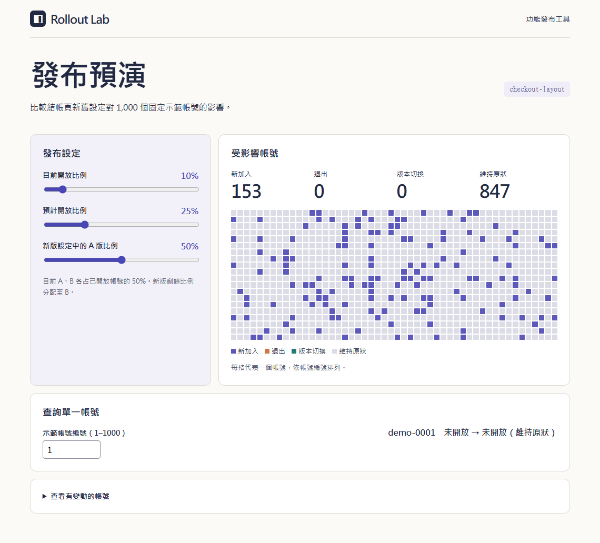

# Rollout Lab｜功能發布預演

發布新版結帳頁前，先試算擴大開放、調整 A/B 配比或回退版本會影響哪些人。工具使用 1,000 個固定合成帳號，列出新加入、退出、切換版本與維持原狀的人數；也能直接查詢某個帳號的前後版本。運算均在瀏覽器本機完成。



## 三分鐘展示

使用 Python 3.10 以上，從儲存庫根目錄啟動：

```sh
python -m http.server 4177 --bind 127.0.0.1 --directory web
```

在現代瀏覽器開啟 [本機預演頁](http://127.0.0.1:4177)。示範本身使用標準瀏覽器 API，無須建置。

1. 預設將開放比例從 10% 擴至 25%，兩邊的 A/B 配比皆為 50/50。固定樣本中，開放帳號由 96 個增加到 249 個，新增 **153 個**，退出及版本切換皆為 0。門檻作用在一萬個雜湊桶上，有限樣本的實際人數會有抽樣差異。
2. 把目前與預計開放比例都調到 100%，再把新版設定的 A 版比例調為 0%。原本拿到 A 的帳號會切到 B，原本拿到 B 的人維持原狀。
3. 展開變動名單查看前 20 筆，或輸入編號 1 至 1000，核對單一帳號。將預計開放比例降到 0% 可展示回退後的退出人數。

## 可重現的分組協定

單一帳號的判定方式如下，權重與門檻都以整數基點指定，10,000 基點等於 100%。[共用 JavaScript 模組](web/rollout.js)

```js
import { subjectBuckets, compilePolicy } from "./web/rollout.js";

const buckets = await subjectBuckets("checkout-layout", "demo-0001");
const assign = compilePolicy({
  rollout: 2500,
  variants: [{name: "A", weight: 5000}, {name: "B", weight: 5000}]
});
console.log(assign(buckets)); // A、B 或 null（未開放）
```

1. 將功能鍵與帳號識別字正規化為 Unicode NFC，保留大小寫。將 `[1, domain, flag, subject]` 以緊密 JSON 序列化為 UTF-8。
2. 使用 SHA-256 雜湊，取前四個位元組組成無號大端整數 `n`。桶號為 `floor(n × 10000 / 2³²)`。
3. `domain` 使用 `exposure` 決定是否開放，使用 `variant` 決定開放後取得的版本。開放條件為桶號小於門檻，版本依清單順序與累積權重分配。提高門檻時，原本已加入的帳號仍在開放區間。若變更版本順序或權重，則可能切換版本。

功能鍵、帳號與協定版本固定時，跨執行環境可重建相同的分組。更換功能鍵等同重新分組，適合另一個獨立實驗。

## 工程驗證

### 用 CI 檢查整段發布計畫

瀏覽器預演可查閱 1,000 個示範帳號。若要評估多階段計畫，命令列工具可涵蓋全部 10,000 × 10,000 種「開放桶號、版本桶號」組合，並追蹤指定帳號。從儲存庫根目錄使用 Node.js 22 以上執行。

```sh
node plan.js examples/checkout-plan.json demo-0090
```

計畫先將開放比例從 10% 提至 25%，接著把 A/B 配比從 50/50 改為 80/20，最後恢復最初的設定。下表的分母皆為一億種桶號組合。

| 階段變更 | 加入 | 退出 | 已開放且切換版本 |
| --- | ---: | ---: | ---: |
| 擴大開放 | 15% | 0% | 0% |
| 調整 A/B 配比 | 0% | 0% | 7.5% |
| 恢復初始設定 | 0% | 15% | 3% |

共有 18,000,000 種組合曾改變，這些組合最後全都恢復初始分組。同一種組合經過多次變動只計一次。`demo-0090` 的桶號為 (144, 6561)，四個階段依序取得 B、B、A、B。這裡的百分比衡量設定覆蓋的桶號空間；實際使用者人數需依功能鍵和帳號清單另行統計。[四階段範例](examples/checkout-plan.json)

計畫的 `limits` 可設定三種整數基點上限。工具以完整桶數和上限比較，剛好等於上限就通過。

| 設定欄位 | 比對對象 |
| --- | --- |
| `maxEverChangedBps` | 整段計畫中至少一次偏離初始分組的組合 |
| `maxFinalChangedBps` | 最後階段與初始分組不同的組合 |
| `maxSwitchedBpsPerStep` | 任一相鄰階段中持續開放、但版本名稱變更的組合 |

將範例的 `maxEverChangedBps` 從 1800 改為 1799，即使回退完全復原，報告仍會列出實際值 18,000,000 和允許值 17,990,000。結束碼 `0` 表示通過，`1` 表示超過限制，兩者都輸出完整 JSON。`2` 表示輸入無效。

演算法以所有版本權重的累積邊界切分區間。對每個區間，開放門檻最高與最低之間的桶號必定有過進出；低於最低門檻的桶號全程開放，只須檢查版本名稱是否改變。若有 S 個階段、B 個不同的版本邊界，掃描區間需 O(S × B) 的比較，無須逐一走訪一億個組合。測試另產生 128 份計畫，在每份計畫的 20 × 20 等比例網格上逐格計算，核對逐階段與全程結果。[實作](web/plan.js) · [測試](test/plan.test.js)

### 執行測試

```sh
npm ci
npm test
python reference.py
npx playwright install chromium
npm run test:e2e
```

需要 Node.js 22 以上。JavaScript 與獨立的 [Python 參考實作](reference.py)各自核對 [8 組固定測試向量](vectors.json)，包含組合字元、引號、換行、中文與 emoji。單元測試驗證門檻邊界、擴量穩定性、反向回退及版本權重變動。Playwright 在桌面及手機寬度驗證鍵盤操作、名單、單一帳號查詢與輸入錯誤。[CI 工作流程](.github/workflows/ci.yml)

**履歷用語**　以 JavaScript 實作多階段功能發布檢查，按權重區間精確計算一億種桶號組合的加入、退出與版本切換，並讓 CI 檢查整段發布的影響上限。

本專案為 AI 輔助開發的作品集示範。
