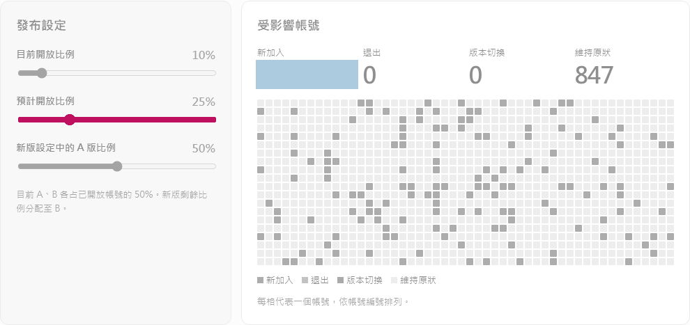

# Frame Delta｜給 CI 使用的截圖差異定位工具

發布設定頁的帳號數量從 153 更新為 999，同時有一個比例滑桿消失。兩張 PNG 總共有 3,210 個像素不同。Frame Delta 可以排除允許變動的數字欄位，回報消失的控制項位在哪裡，並產生可附在失敗 CI 作業上的差異圖。



圖片擷取自同一個 Chromium 視窗與同一版 Rollout Lab。候選畫面只在瀏覽器中將 `#entered` 的文字改為 999，並對 `#proposed` 套用 `visibility: hidden`，用以重現介面退化。[來源版本](https://github.com/peca12968/rollout-lab/tree/bc089125414757db90404e9cbab6dd7461153dab/web) · [基準畫面](examples/baseline.png) · [候選畫面](examples/candidate.png)

## 重現滑桿消失

使用 Go 1.25 以上，執行檔只依賴標準函式庫。

```sh
go build -o frame-delta .
./frame-delta -ignore 367,86,147,42 -diff review.png examples/baseline.png examples/candidate.png
```

Windows 可使用 `go build -o frame-delta.exe .` 並執行 `.\frame-delta.exe`。範例預期以結束碼 1 結束，stdout 仍會輸出可解析的 JSON。遮掉數字欄位後，剩餘差異為 **2,352 個像素，集中在一塊區域**。左上角座標為 (26, 164)，寬 284、高 16 像素。差異圖以候選畫面為灰階底圖，桃紅色表示有變化的位置，藍色是排除區域。

| 參數 | 用途 |
| --- | --- |
| `-ignore x,y,width,height` | 排除一個矩形，可重複指定。重疊部分只計算一次。 |
| `-tolerance N` | RGB 任一色彩通道的差距超過 N 才計入差異。預設 0，可設 0 到 255。 |
| `-budget N` | 允許最多 N 個差異像素，預設 0。範例門檻設成 2,351 會失敗，設成 2,352 會通過。 |
| `-diff PATH` | 寫入診斷用 PNG。兩張輸入圖均以唯讀方式開啟。 |

結束碼 0 表示通過，1 表示超過門檻，2 表示無法完成比較，例如圖片尺寸不同或遮罩超出邊界。工具接受每張最多 1,200 萬像素的 PNG。做版面回歸時，應用相同的視窗大小、縮放、字型與瀏覽器擷取基準和候選畫面。

## 如何定位差異

兩張圖先合成至白底，將可見顏色換算成 8 位元 RGB。工具逐像素比較，再從每個有差異的像素向上下左右尋找相鄰差異。斜角接觸會分成兩區。報告列出全部區域數及面積最大的十區，同面積依第一個像素的掃描順序排序。座標從左上角開始，右、下邊界為半開區間。運算適合相同渲染環境的截圖，不包含感知色差、色彩描述檔轉換或自動對齊。[比對與區域搜尋實作](compare.go)

### 獨立驗證

```sh
python -m pip install Pillow==13.0.0
python -m unittest -v
```

測試編譯並執行 Go 命令列工具。Python 為 48 組可重現圖樣逐列合併水平像素段，獨立核對區域數、前十區的範圍與面積，也逐像素檢查輸出的差異圖。另測全透明像素、半透明顏色、相等門檻、重疊遮罩及錯誤輸入保留既有檔案。[黑箱測試](test_cli.py)

本專案使用 AI 輔助開發，範例頁面只含合成資料。
